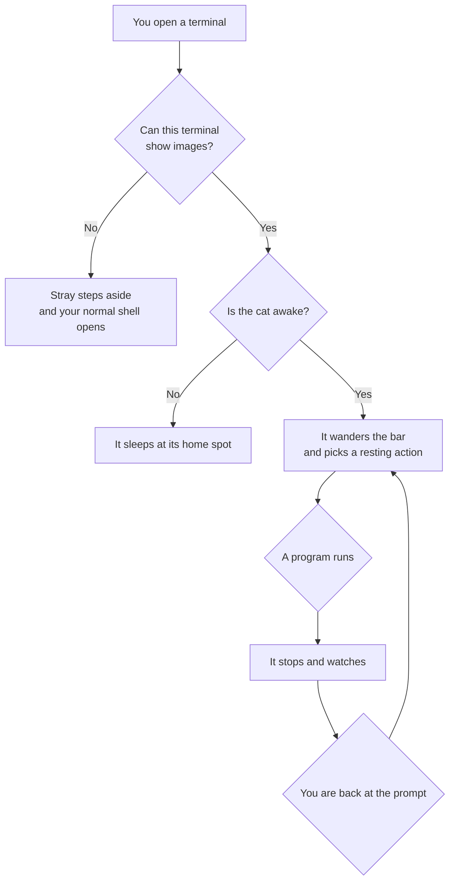

# Design

* What Stray is and how the cat behaves.
* How it is built: [ARCHITECTURE.md](ARCHITECTURE.md). What comes next: [ROADMAP.md](ROADMAP.md).
* This describes the planned behavior. See the [roadmap](ROADMAP.md) for current progress.

## Contents

1. [Overview](#overview)
2. [Key Terms](#key-terms)
3. [The Screen](#the-screen)
4. [In The Bar](#in-the-bar)
5. [The Cat's Day](#the-cats-day)
6. [At Rest](#at-rest)
7. [What It Notices](#what-it-notices)
8. [The Cat's Look](#the-cats-look)
9. [Commands](#commands)
10. [Naming The Cat](#naming-the-cat)
11. [Install And Remove](#install-and-remove)
12. [Supported Terminals](#supported-terminals)
13. [tmux And ssh](#tmux-and-ssh)
14. [Rules That Do Not Change](#rules-that-do-not-change)
15. [Decisions](#decisions)
16. [Left For Later](#left-for-later)
17. [Open Questions](#open-questions)

## Overview

* Stray is a small cat that lives in your terminal.
* It lives in its own space at the bottom of the screen and never leaves it. It sleeps, wanders, and plays there.
* It notices what you do: it looks up when you type, watches while programs run, and flinches when a command fails.
* It keeps its own day by the clock: it eats, naps, and sleeps at set times.
* You can give it a treat, pet it, and name it.

1. **The terminal comes first.** The cat never slows typing or covers your work.
2. **Simple to live with.** Nothing to earn, nothing to keep up with. It is your cat from the first day.
3. **It is easy to quiet.** One command puts the cat to sleep.

## Key Terms

| Term | Meaning |
| --- | --- |
| **Bar** | The bottom two rows of the terminal. They belong to the cat. |
| **Home spot** | The left end of the bar, where the cat starts, sleeps, and keeps its bowl. |
| **Prompt** | The line where your shell waits for a command. |
| **Idle** | The shell is waiting at the prompt, and nothing has been typed or printed for a while. |
| **Schedule** | The times of day the cat eats, naps, and sleeps. |
| **Frame** | One small picture of the cat. |
| **Image check** | Stray asking the terminal at launch whether it can show images. |
| **Pane** | One of the split areas inside a tmux window. |

## The Screen

```
+----------------------------------------------------+
| ~/code > cargo build                               |
|    Compiling stray-cat v0.1.0                      |
|     Finished in 4.2s                               |   your shell and
| ~/code > _                                         |   your programs
|                                                    |
|                                                    |
+----------------------------------------------------+
|                                            /\_/\   |   the bar: two rows
|                                           ( o.o )  |   for the cat
+----------------------------------------------------+
```

* The cat is shown as text here. The real cat is a small image.
* The bar has no line or border. It is empty rows with the cat in them, so the window looks like one normal terminal.
* Programs never draw in the bar. They do not know it exists.
* In a window too short to share, the bar turns off.

## In The Bar



* The cat never leaves the bar. It never walks over your text or sits where you type.
* It can go anywhere along the bar, and it faces the way it walks.
* When you type, it looks up for a moment, then goes on with what it was doing.

## The Cat's Day

* The cat follows the clock on your computer. Every day is the same.

| Time | What The Cat Does |
| --- | --- |
| 7 to 9 am | **Breakfast.** It eats from its bowl in the bar. |
| 1 to 3 pm | **Nap.** It sleeps in the bar. |
| 6 to 7 pm | **Dinner.** It eats from its bowl in the bar. |
| 11 pm to 7 am | **Night.** It sleeps in the bar. |
| Any other time | **Free time.** It wanders the bar and picks a resting action. |

* A meal lasts a few minutes, at the start of meal time or when you open a window during it. Then it is free time.
* At meal and sleep times, the cat walks to its home spot first.
* A sleeping cat stays at its home spot, and typing does not wake it.
* The times are starting numbers in a settings file.

## At Rest

* In free time, the cat picks an action, does it for a while, then picks again.

| Action | What You See | How Often |
| --- | --- | --- |
| **Sit** | Still, with a blink or tail flick. | Most of the time |
| **Walk** | A stroll to a new spot in the bar. | Sometimes |
| **Play** | Bats at something, or pounces. | Sometimes |
| **Run** | A dash from one end of the bar to the other. | Rarely |

## What It Notices

* Every reaction happens inside the bar. A sleeping cat does not react to any of them.

| What Is Happening | What The Cat Does |
| --- | --- |
| You type at the prompt | Looks up for a moment. |
| Output is scrolling by | Sits and watches. |
| A program has run for a long time | Naps until you are back at the prompt. |
| A coding agent stops and waits for you | Perks up. |
| A command fails | Flinches. Not when you stopped it with Ctrl C. |
| A full screen program such as `vim` is open | Sits still. |

* tmux and ssh count as programs too. See [tmux And ssh](#tmux-and-ssh).

## The Cat's Look

* A single color silhouette, in the style of the RunCat menu bar cat, and a little bigger.
* It fills the bar, scaled to your font size.
* It takes the color of your terminal's text.
* It is drawn facing one way. Stray flips it to face the other.
* The art is original. No frames are copied from RunCat.

| Pose | Status | Used For |
| --- | --- | --- |
| Sleeping | Drawn, 27 frames | Naps and night. |
| Waking | Drawn, 5 frames | Waking from a nap or at morning. |
| Standing up | Drawn, 6 frames | Getting up into a sit after waking. |
| Sitting | Drawn, 16 frames | Resting and watching. |
| Sitting down | Drawn, 4 frames | Sitting down after a walk. Played backwards to get up. |
| Walking | Drawn, 8 frames | The walk action, and going to the home spot. |
| Running | Drawn, 8 frames | The run action, and chasing the ball. |
| Turning | Drawn, 2 frames | Turning around while standing: a three quarter view, then facing you. Played, then flipped and played backwards. |
| Leaning in | Drawn, 3 frames | Leaning from the sit down to the bowl. Played backwards to sit up. |
| Eating | Drawn, 8 frames | Meals and treats, with its face in the bowl. |
| Playing | Drawn, 17 frames | The play action: crouch, wiggle, pounce, and bat the ball. |
| Reactions | Drawn, 17 frames | Looking up, flinching, perking up, and being petted, with purr marks. Each plays forward, then backward to settle. |

* Every pose uses the same cat as the sleeping frames.
* The face has two eyes and no nose, and a soft grey line inside each ear.
* The sprites live in `assets/sprites`, one folder per pose.
* A cat tree stands in the bottom left corner: a rope post, a shelf with a toy ball hanging from it, and a bed with one arm on top. It is only there to look at; the cat does not climb it.
* The bowl is its own image. It sits between the cat tree and the home spot, and is drawn in front of the cat.
* To eat, the cat comes home facing the bowl, sits, and scoots up to it as it leans in, and back as it sits up.
* The ball is its own image too. It stays where it last rolled. The cat moves forward as it pounces.

## Commands

| Command | Does |
| --- | --- |
| `stray treat` | Gives the cat a treat. It eats it, even if it was asleep, then goes back to what it was doing. |
| `stray pet` | Pets the cat. It purrs. A sleeping cat purrs in its sleep. |
| `stray name <name>` | Names the cat. See [Naming The Cat](#naming-the-cat). |
| `stray quiet` | The cat sleeps in the bar and nothing moves. |
| `stray come` | Wakes the cat. Ends `quiet`. |
| `stray install` | Adds Stray to your shell. |
| `stray uninstall` | Removes Stray from your shell. |

* There is one cat, so a command applies in every window.

## Naming The Cat

* `stray name mochi` names the cat Mochi.
* In windows you open after that, `mochi` works in place of `stray`. For example, `mochi treat`.
* `stray` always keeps working.
* The name must be one word: letters, numbers, and dashes.
* If you already have a command with that name, Stray says so and does not add it.

## Install And Remove

1. Get the program:

   ```sh
   cargo install stray-cat
   ```

2. Add it to your shell:

   ```sh
   stray install
   ```

3. Open a new terminal.

* `stray install` adds one line to the startup file of bash or zsh.
* In VS Code, also turn on `terminal.integrated.enableImages`.
* In tmux, also add `set -g allow-passthrough on` to `~/.tmux.conf`. `stray install` tells you if it is missing. It never edits that file.
* The package is `stray-cat` because `stray` was taken on crates.io. The command is `stray`.

## Supported Terminals

* Stray runs on macOS and Linux. macOS is tested in every phase.
* At launch, Stray asks the terminal whether it can show images.
* Yes: Stray runs. No: Stray steps aside and your normal shell opens.
* There is no text version of the cat.

| Terminal | Status |
| --- | --- |
| kitty | Main target. Tested in every phase. |
| VS Code terminal | Tested in every phase. Needs version 1.110 or newer, with `terminal.integrated.enableImages` on. |
| iTerm2, Ghostty, WezTerm, and Warp | Should work. Untested. |
| Terminals that cannot show images, such as the macOS Terminal app | Not supported. |

* The first time a terminal says no, Stray prints one line that says why. After that it stays silent.

## tmux And ssh

* There is one cat, and it lives on your own machine. tmux and ssh never add a second cat to the same screen.

| Where You Are | What Happens |
| --- | --- |
| tmux started from a Stray window | tmux is a program like any other. The cat stays in the window's bar. The panes get no cat of their own. |
| tmux started on its own | Each pane gets its own bar with the same cat. Needs tmux 3.3 or newer with `allow-passthrough` on. |
| ssh from a Stray window | ssh is a program like any other. The cat watches from your bar, and naps when nothing happens for a while. |
| A shell on the far machine | If Stray is installed there too, it steps aside. |

* If tmux has `allow-passthrough` off, the image check says no and Stray steps aside. The one line it prints names the setting.

## Rules That Do Not Change

1. **The terminal comes first.** Every key reaches your shell before the cat reacts.
2. **The cat never covers your work.** It never leaves the bar.
3. **A broken Stray never locks you out.** If it cannot start, your normal shell opens. If it crashes later, your terminal is put back the way it was.
4. **Easy to quiet, easy to remove.** One command each.
5. **Nothing leaves your machine.** No network and no account.
6. **One way to draw.** The cat is always an image.
7. **One cat.** Every window shows the same cat on the same schedule.

## Decisions

| Decision | Why | What It Costs |
| --- | --- | --- |
| No hours and no trust stages | Simpler to build and to understand. | The cat does not change over time. |
| The cat's day follows the clock | Gives it a life with no saved data. | Every day is the same. |
| Bar at the bottom | Scrolling back keeps working, and the prompt is usually just above. | In a fresh window the prompt is far from the bar. |
| Bar is two rows | Room for the cat and its bowl. | Less space in short panels. |
| No line around the bar | The terminal looks the same as without Stray, plus a cat. | Nothing shows where the shell's rows end. |
| Stray runs your shell inside itself | The only way to animate while you type. | Harder to build. |
| Image only, no text cat | A smooth cat and one way to draw. | Terminals without images get nothing. |
| The cat always stays in the bar | It is never in your way, and programs cannot erase it. There is no need to find empty space on the screen. Much simpler to build. | It never visits your prompt. |
| Keys only, not the mouse | Watching the mouse breaks text selection and clashes with programs like `vim`. | Moving the mouse does nothing. |
| Commands start with `stray`, or the cat's name | Works in every shell. A name makes it personal. | No `/treat` style commands. |
| Command `stray`, package `stray-cat` | The short name was taken. | Two names at install. |
| One cat per screen with tmux and ssh | Two cats on one screen would fight over it. | A far machine never gets a cat of its own. |

## Left For Later

* The mouse scaring the cat.
* A different schedule on weekends.
* Hunger that grows if you skip treats.
* A bed, a toy, and other items in the bar.
* Other shells, such as fish.
* Testing iTerm2, Ghostty, and other terminals that pass the image check.
* Done notifications. See below.

### Done Notifications

* A possible future addition, not planned in any phase yet.
* When a long command or a coding agent finishes while you are away from the window, Stray sends a desktop notification. For example: "Mochi: cargo build finished", or "failed".
* If you are watching the window, there is no notification. The cat just perks up in the bar.

| Piece | How |
| --- | --- |
| The command finished | The prompt mark, which already says when the `>` is back and whether the command failed. |
| It ran long enough | Time from when a program takes over to when the prompt is back. Only runs of about 10 seconds or more count, so `ls` never notifies. |
| What it was | The foreground program's name, such as `cargo` or `claude`. |
| An agent is waiting | A coding agent is in front and its output has gone quiet. A guess, not always right. |
| You are away | Focus reporting: the terminal tells Stray when the window gains or loses focus. kitty and VS Code support it. |
| The notification | kitty's desktop notification code. Terminals without it get the bell. |

* `stray notify on` and `stray notify off` would turn it on and off.
* Hard parts: programs such as `vim` and Claude Code turn on focus reporting for themselves, so Stray must pass those focus messages through only when the program asked for them. Notifications in VS Code are untested. tmux needs `focus-events on`.
* Claude Code can already send its own notifications, so this helps most with builds, tests, and other long commands.

## Open Questions

1. Are the schedule times right?
2. Should `stray quiet` give the two rows back to the shell?
3. Is two rows tall enough for the cat, or should the bar be three?
