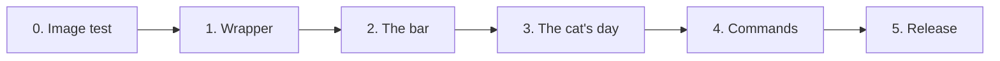

# Roadmap

* What Stray does today, what has been tested, and what comes next.
* A feature is complete only after it has run in a real terminal.
* Last updated October 30, 2026.

## Contents

1. [Status](#status)
2. [Complete](#complete)
3. [Next](#next)
4. [Planned](#planned)
5. [Later Ideas](#later-ideas)
6. [Known Risks](#known-risks)
7. [Open Questions](#open-questions)
8. [Test Record](#test-record)

## Status

| Phase | Goal | Status |
| --- | --- | --- |
| 0 | An image test: a cat running along the bottom rows | Complete |
| 1 | A wrapper you cannot notice | Complete, per user report on October 14 |
| 2 | The image check, and the bar with a cat that sits still | Image check and basic row reservation implemented; terminal checks pending |
| 3 | The cat's day, resting actions, and reactions | Done in code October 30, 2026; mostly checked in kitty, VS Code pending |
| 4 | Commands to treat, pet, quiet, and name the cat | Planned |
| 5 | A public release | Planned |

* Phase 0 is a throwaway test. Every later phase leaves Stray usable every day.
* A phase is complete when its **Done when** line is true in kitty and in the VS Code terminal, on macOS.
* On October 5, 2026 the plan was made simpler. Hours, trust stages, `stray stats`, and the habitat were dropped. The cat now keeps a daily schedule.
* On October 28, 2026 the prompt phase was dropped. The cat stays in the bar the whole time and reacts from there.

## Complete

### Phase 0: The Image Test

* **Built:** `stray-image-test` in `src/bin/stray-image-test.rs`, a small program with no outside libraries.

1. Asks the terminal whether it can show images, and exits with a message if not.
2. Draws 12 frames of a placeholder cat with smooth edges, and a flipped copy of each.
3. Uploads them and runs the cat along the bottom two rows and back.
4. `--resend` sends the whole picture on every step, to compare if placing by ID flickers.
5. `--dark` draws a dark cat for light backgrounds.
6. q or Ctrl C stops it early and cleans up.

* **How to run:** `cargo run --release --bin stray-image-test`, then again with `-- --resend` and `-- --dark`.

* **Done when:** the cat runs there and back in both terminals with no flicker, no gaps, and nothing left behind.
* **Result:** done in `--resend` mode. Placing by ID works in kitty but not in VS Code. See the [Test Record](#test-record).
* Image support inside tmux remains deferred to Phase 2, including Linux testing.

### Phase 1: The Wrapper

* All eight items below are implemented. Automated checks pass on macOS and Linux.
* The user reported testing finished on October 14 and requested Phase 2.
* The earlier [terminal checklist](PHASE1-TESTING.md) remains available for regression checks.

1. `stray start` runs your shell in a PTY and passes every key and all output through.
2. The inner shell starts as a login shell when the first one was.
3. It handles resizes and exits with the shell's exit code.
4. If it cannot start, it runs your shell directly.
5. If it crashes later, it puts the terminal back to normal and prints one line.
6. The mark holds the name of Stray's PTY, so a leaked copy does not stop a new window from starting Stray.
7. Inside ssh sessions, and inside tmux started from a Stray window, Stray steps aside.
8. `stray install` and `stray uninstall` add and remove the startup line.

* **Done when:**
  * `vim`, Claude Code, tmux, ssh, colors, Ctrl C, and resizing behave the same inside Stray as outside.
  * Everything set in `~/.zprofile`, such as `PATH`, is still there inside Stray.
  * `code .` and a new kitty window opened from a Stray shell both start their own Stray.
  * Typing feels no slower. Printing a large file takes about as long as without Stray.

## Next

### Phase 2: The Bar

* The hardest phase.
* Done in code October 29, 2026, apart from tmux. Real-terminal checks are still
  pending: see [Phase 2 testing](PHASE2-TESTING.md).
* tmux moved to a later phase. Inside tmux, Stray keeps the bar rows but draws nothing.

1. Run the image check. If it fails, run the shell directly and print the hint once. Done.
2. Reserve the bottom two rows. Done.
3. Color the frames to match the terminal's text. Done: the check asks for the text and background colors.
4. Place a cat that sits still in the home spot. Done, with the bowl and the cat tree.
5. Keep the bar and the cat whole through clears, full screen programs, resets, and resizes. Done.
6. Stop programs from moving the cursor into the bar. Done.
7. Draw only between pieces of output, and wait for batched updates to end. Done.
8. Turn the bar off in windows shorter than 10 rows. Done.

* **Done when:**
  * The bar is correct after `clear`, `vim`, a long build, a Claude Code session, and ten resizes.
  * Scrolling back works as it does without Stray.
  * A program that shows its own images, such as `kitten icat`, and the cat do not disturb each other.
  * An ssh session shows one cat, in your own bar.

### Phase 3: The Cat's Day

* Done in code October 30, 2026. Most of the checklist passed in kitty. What is left
  is in issues [#16](https://github.com/ado11231/stray/issues/16),
  [#17](https://github.com/ado11231/stray/issues/17), and
  [#18](https://github.com/ado11231/stray/issues/18). See [Phase 3 testing](PHASE3-TESTING.md).

1. Read the local time and turn it into meal, nap, night, or free time. Done.
2. Add the test setting that shifts the clock. Done: `STRAY_CLOCK` and `STRAY_CLOCK_SPEED`.
3. Add the modes: free, watching, eating, and sleeping. Done.
4. Add the resting actions: sit, walk, play, and run. Done. Play has no ball yet.
5. Add the prompt mark to the bash and zsh setup, to know when a command failed. Done. The mark stays in the output.
6. Read the foreground program. Done.
7. Add the reactions: looking up at a key, coding agents, long runs, and failed commands. Done.
8. Draw the rest of the frames in the style of the sleeping cat, and the bowl. Done October 29, 2026: every pose has a first version.

* **Done when:**
  * With the clock shifted, the cat eats, naps, and sleeps at the right times, in every open window.
  * Typing does not wake a sleeping cat.
  * The cat looks up when you type, and flinches when a command fails.
  * Left alone for ten minutes in free time, the cat does each resting action.

## Planned

### Phase 4: Commands

1. `stray treat` and `stray pet`. Each saves the time it was run, and each window reacts once.
2. `stray quiet` and `stray come`.
3. `stray name`, and the name as a command in new windows.

* **Done when:**
  * A command in one window changes the cat in every window within a second.
  * After `stray name mochi`, `mochi treat` works in a new window.
  * A name that is already a command is refused.

### Phase 5: Release

* Publish `stray-cat` on crates.io.
* A README with a short recording.
* A Homebrew package and a license.
* **Done when** a newcomer goes from install to a cat in their terminal in under two minutes.

## Later Ideas

* tmux, moved out of Phase 2 on October 29, 2026: pass image codes through and show
  the cat with placeholders, so it follows its pane. Done when tmux started from a
  Stray window shows one cat, in the window's bar, and tmux started on its own shows
  a whole bar in every pane that stays put when you switch panes and windows.

1. The mouse scaring the cat.
2. A different schedule on weekends.
3. Hunger that grows if you skip treats.
4. A bed, a toy, and other items in the bar.
5. Other shells, such as fish.
6. Testing iTerm2, Ghostty, and other terminals that pass the image check.
7. Done notifications: a desktop notification when a long command or a coding agent finishes while you are away. See [Done Notifications](DESIGN.md#done-notifications).

## Known Risks

* Details are in [Hard Parts](ARCHITECTURE.md#hard-parts).

1. VS Code's image support is new. Placing frames by ID fails there, so Stray sends each frame again.
2. kitty and VS Code may handle the scroll region differently.
3. Coding agents redraw the screen often.
4. The wrapper may slow typing.
5. Tools that run on Node may show the name `node`, so they would not count as coding agents.
6. Two rows may be too much in the short VS Code panel.
7. Placeholders inside tmux may only work in kitty.
8. Many tmux panes mean many bars, which may feel crowded.
9. Run is the rarest action. In tests, a cat left alone for ten minutes skipped it about 1 time in 40.
10. Any bytes from the terminal count as a key, including focus and mouse reports, so the cat may look up at them.

## Open Questions

1. Are the schedule times right?
2. Should `stray quiet` give the two rows back to the shell?
3. Is two rows tall enough for the cat?
4. Is a 3 minute meal and a 2 minute wait before a nap right?

## Test Record

### Phase 3: October 30, 2026, The Cat's Day

* Automated checks pass locally on macOS: formatting, Clippy with warnings denied,
  and every test.
* New tests cover the schedule and the test clock, the steps and plans, every mode,
  the resting actions, looking up, flinching, perking up, and napping on long runs.
* PTY tests run real bash 3.2 and zsh to check the prompt mark, and a job control
  shell to check the foreground program, including a program started as `claude`
  through a link, the way npm starts Claude Code.
* The user tried some steps in a real terminal as they were built, and reported
  that they worked: the cat moves on its own, looks up while typing, flinches at a
  failed command, and perks up when Claude Code waits. The terminal was not
  recorded, and the full checklist has not been run.

#### kitty, macOS, zsh

| Check | Result |
| --- | --- |
| Breakfast at speed 60: walks to the bowl, turns, eats, sits | Passed |
| Nap: sleeps, typing and `false` do not wake it, wakes after 2 minutes | Passed |
| Dinner into night at speed 600, and a new window at night starts asleep | Passed |
| Walking | Stuttered at the start and end. Fixed by placing frames with a pixel offset, then passed |
| Looks up while typing, flinches on `false` | Passed |
| `sleep 10` at speed 60: watches, then naps, wakes at the prompt | Passed |
| `claude`: stays awake, perks up when it waits | First napped, because npm's file is `claude.exe`. Fixed, then passed |
| Free time for ten minutes | Not run: [#16](https://github.com/ado11231/stray/issues/16) |
| `vim`, Ctrl C, and an empty Enter | Not run: [#17](https://github.com/ado11231/stray/issues/17) |
| The whole checklist in VS Code | Not run: [#18](https://github.com/ado11231/stray/issues/18) |

### Phase 2: October 14, 2026, Image Check

* Automated checks pass locally on macOS: 74 tests, formatting, Clippy with
  warnings denied, and a release build with the lockfile.
* PTY tests cover support, rejection, timeout, shell exit status, and keys typed
  during the check. Existing resize tests now send a positive image reply.
* Parser tests cover split replies, unrelated input, reply ordering, and tmux
  query wrapping. A concurrent test checks that only one window claims the hint.
* Real-terminal image checks, tmux passthrough, and Linux CI are not yet verified
  for this change. No bar or cat is drawn yet.

### Phase 1: October 14, 2026, User Follow-up

* The user reported that Phase 1 testing was finished and asked to continue to
  Phase 2. No individual terminal results or new measurements accompanied that
  report. The earlier detailed record below is preserved as it was recorded.

### Phase 1: October 14, 2026, Automated And PTY Checks

* Tested code: `3aa187f`, on the CI branch in [PR #1](https://github.com/ado11231/stray/pull/1).
* Local system: macOS 26.5.2, arm64, Rust 1.99.0.
* No kitty or VS Code window results have been recorded for this phase yet.

| Check | Result |
| --- | --- |
| Formatting and Clippy with warnings denied | Passed locally and in GitHub Actions. |
| Automated tests | All 62 passed locally and on Linux and macOS CI runners. |
| Release build with the lockfile | Passed locally. |
| Rust 1.89 compatibility | All targets checked successfully on Linux CI. |
| Input, output, resize, and exit status | Automated tests passed, including repeated PTY resizing. |
| Startup failure, caught panics, and termination signals | Automated fallback and cleanup tests passed. |
| bash and zsh startup guards | Automated login, stale-marker, SSH, and tmux guard tests passed. |
| Installer edits | Automated duplicate, removal, symlink, and permission tests passed. |
| Login profile settings | A temporary zsh login profile kept its variable and PATH entry inside Stray. |
| Colors | ANSI color bytes reached the outer PTY. Visual appearance is pending. |
| Ctrl C | Interrupted `sleep 30`, returned to the prompt, and reported status 130. |
| vim 9.1 | Opened in the wrapped PTY, saved typed text, and returned to the shell. |
| tmux 3.7b | Attached to an isolated server, ran a pane command, and returned to the shell. The pane inherited Stray's outer marker. |

The extra PTY checks used the release binary and temporary zsh startup files.
They did not change personal shell settings or use existing tmux sessions.
They establish process and byte behavior, not visual correctness in a terminal app.

#### Forwarding Measurements

One local sample compared direct login zsh with login zsh through Stray.
Both used an outer PTY, the same temporary profile, and a 24 by 80 terminal.
Output measurements used a 4 MiB text file, one warm-up, then five timed runs.
Key measurements used 100 individual typed characters and waited for each echo.

| Measurement | Direct shell | Through Stray |
| --- | --- | --- |
| Median time to receive 4 MiB | 46.1 ms | 42.0 ms |
| Median key echo | 0.016 ms | 0.035 ms |
| 95th percentile key echo | 0.018 ms | 0.043 ms |

The reader checked that all payload characters arrived. Timings include PTY I/O
and the test reader, but exclude GUI rendering. The small output-time difference
does not establish a speedup. Real-terminal performance remains unverified.

#### Remaining Acceptance Checks

| Check | kitty | VS Code |
| --- | --- | --- |
| Typing, paste, history, and colors look and feel normal | Pending | Pending |
| vim, Claude Code, tmux, Ctrl C, and repeated window resizing | Pending | Pending |
| SSH session and return to the local shell | Pending | Pending |
| Personal login profile settings remain available | Pending | Pending |
| New windows started from Stray get their own wrapper | Pending | Pending |
| Large-file output speed and scrollback | Pending | Pending |

These were the outstanding checks at the time of this earlier record.

### Phase 0: October 2, 2026, kitty And VS Code

* Run on macOS by the user.

| Terminal | Mode | Frames placed | Result |
| --- | --- | --- | --- |
| kitty | by ID | 215 | The cat ran there and back. |
| kitty | `--resend` | 215 | The cat ran there and back. |
| VS Code, images on | by ID | 285 | The cat showed for about a second, then vanished. The program kept going to the end. |
| VS Code, images on | `--resend` | 285 | The cat ran there and back. |
| VS Code, images off | either | none | It said the terminal cannot show images, and exited. |

* The frame counts differ only because the windows were different widths.
* The cat vanished after about 12 steps, one loop of frames. So in VS Code, removing a frame from the screen also deletes the uploaded picture. After the first loop there is nothing left to place.
* Result: Stray sends the frame with every change instead of placing it by ID. See [Drawing The Cat](ARCHITECTURE.md#drawing-the-cat).
* Not tested: tmux. It moves to Phase 2.

### Phase 0: October 2, 2026, Written Again, No Real Terminal Yet

* The first version was not in this repository, so the image test was written again from the plan above.
* Checked on macOS with no terminal window.

1. `cargo build --release`, `cargo test`, and `cargo clippy` passed with Rust 1.99, with no warnings.
2. The 6 unit tests cover base64, reading the image check reply, the path, the frames, flipping, and the options.
3. Run with no terminal, it said it must run in a terminal window and exited.
4. Not tested: any real terminal. How the cat looks is unknown.
